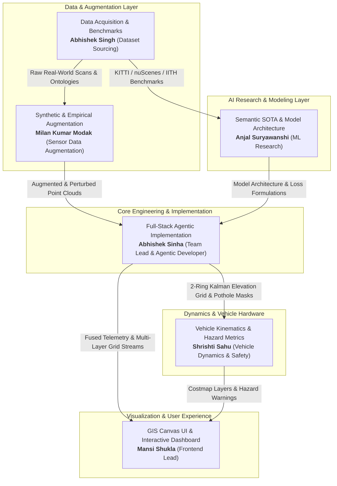
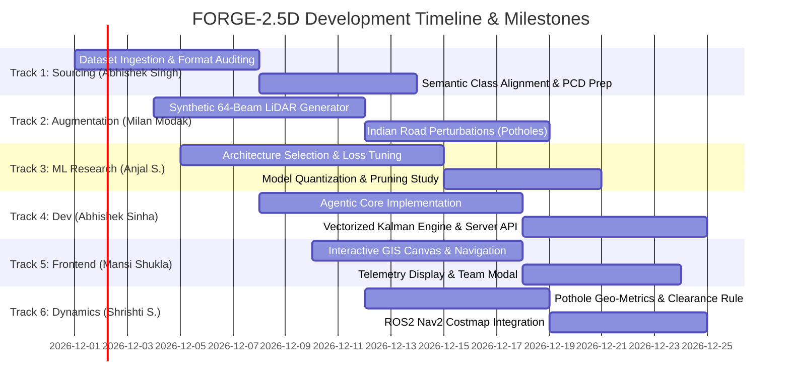

# FORGE-2.5D: Project Work Breakdown Structure & Team Allocation Guide
**Smart India Hackathon 2026 (SIH 2026)**  
**Problem Statement ID:** `SIH26053`  
**Problem Statement Title:** *Adaptive Variable-Resolution 2.5D LiDAR Mapping for Dynamic Environment Perception*  
**Theme / Category:** Smart Vehicles / Software  
**Team ID:** `146825`  
**Team Name:** `BYTEFORCE123`  

---

## 1. Executive Summary & Architecture Overview

**FORGE-2.5D** is an edge-optimized spatial perception framework designed to replace resource-heavy 3D point cloud representations with an adaptive, 2-ring foveated 2.5D elevation grid. By concentrating sub-decimeter cell resolution ($5\text{ cm}$) in the critical near field ($0\text{--}10\text{ m}$) where collision avoidance and ground hazard negotiation occur, and coarsening cell resolution ($25\text{ cm}$) in the intermediate field ($10\text{--}50\text{ m}$), FORGE-2.5D achieves:
- **$\ge 93.8\%$ memory footprint reduction** compared to uniform 2.5D grids ($7.51\text{ MB}$ vs. $120.93\text{ MB}$).
- **$\ge 99.8\%$ memory footprint reduction** compared to dense 3D voxel grids ($7.51\text{ MB}$ vs. $3.84\text{ GB}$).
- **Real-time pipeline turnaround ($\ge 22\text{--}25\text{ FPS}$)** on embedded automotive-grade edge compute (NVIDIA Jetson Orin / Xavier).

To execute the project from rapid prototype to final production-grade deployment, the development roadmap is structured across **6 specialized functional tracks** precisely aligned with team members' designated domain roles.



---

## 2. Team Member Profile & Functional Role Matrix

| Member Name | Official Role in Project | Email Address | Core Functional Ownership |
| :--- | :--- | :--- | :--- |
| **Abhishek Sinha** | **Team Leader & Developer (Agentic Coding)** | `abhi.bt23cs07@opju.ac.in` | End-to-end framework architecture, rapid agentic coding & automation, core algorithm development (voxelizer, Kalman grid, API server), pipeline integration, and technical orchestration. |
| **Abhishek Singh** | **Dataset Sourcing Specialist** | `abhi.bt23cs06@opju.ac.in` | Identification, acquisition, and curation of real-world LiDAR datasets (IITH, SemanticKITTI, nuScenes, Waymo), point cloud format standardization (PCD/BIN/LAS), ground truth semantic verification. |
| **Milan Kumar Modak** | **Sensor Data Augmentation Specialist** | `mila.bt23cs57@opju.ac.in` | Synthetic scene generation (64-beam urban LiDAR simulator), environmental perturbations (rain/fog/noise attenuation), domain adaptation for Indian road conditions (unmarked curbs, irregular potholes). |
| **Anjal Suryawanshi** | **Machine Learning Research Lead** | `anjal874suryawanshi@gmail.com` | SOTA survey (spconv, MinkowskiEngine, PointNet++), loss function design for imbalanced road classes, model optimization, FP16/INT8 quantization strategies for edge deployment. |
| **Mansi Shukla** | **Frontend Lead** | `shuklamansi568@gmail.com` | User interface architecture, Google Maps-style interactive 2D canvas (pan/zoom/center), multi-source dataset controls, layer toggles, cell hover inspector, and team credentials modal. |
| **Shrishti Sahu** | **Vehicle Dynamics & Safety Engineer** | `shri.bt23me30@opju.ac.in` | Mechanical safety envelopes, vehicle clearance / approach-departure angle constraints, pothole depth grading & suspension impact metrics, ROS2 Nav2 costmap translation. |

---

## 3. Detailed Track Breakdown & Task Allocation



---

### Track 1: Dataset Sourcing & Curation
- **Lead Owner:** **Abhishek Singh**
- **Objective:** Establish the data foundation for training, testing, and real-time benchmarking across both structured and unstructured environments.

#### Core Deliverables:
1. **Multi-Benchmark Dataset Ingestion**:
   - Collect and catalog open-source autonomous vehicle datasets: SemanticKITTI, nuScenes, and local Indian LiDAR archives (e.g., IITH Ground Dataset).
   - Clean, structure, and verify the integrity of ASCII/binary PCD scans and coordinate systems.
2. **Semantic Ontology Alignment**:
   - Map external class annotations into FORGE-2.5D's canonical 4-class ontology:
     - `Class 0`: Drivable Surface (Road plane)
     - `Class 1`: Non-Drivable Ground / Curbs / Potholes / Dips
     - `Class 2`: Static Obstacles (Walls, poles, barriers, vegetation)
     - `Class 3`: Dynamic Objects (Vehicles, pedestrians, cyclists, animals)
3. **Data Splitting & Quality Auditing**:
   - Create balanced train/val/test splits emphasizing complex edge cases (sharp slopes, unpaved terrain, water puddles).
   - Maintain data versioning, documentation, and compliance with the `.gitignore` policy.

---

### Track 2: Sensor Data Augmentation & Synthesis
- **Lead Owner:** **Milan Kumar Modak**
- **Objective:** Overcome real-world data scarcity by generating high-fidelity synthetic LiDAR scenes and domain perturbations characteristic of Indian roads.

#### Core Deliverables:
1. **Synthetic Urban LiDAR Scene Generator**:
   - Maintain and enhance the 64-beam synthetic LiDAR model (`forge/data/synthetic_generator.py`) simulating customizable vehicle trajectories, road boundaries, buildings, and moving traffic.
2. **Indian Road Environmental Augmentations**:
   - **Negative Obstacle Synthesis**: Inject parametric potholes, trenches, and severe dips into flat ground surfaces with variable depth ($3\text{--}25\text{ cm}$) and diameter ($0.3\text{--}2.0\text{ m}$).
   - **Dynamic Traffic Insertion**: Augment scenes with unpredictable agents (two-wheelers, auto-rickshaws, crossing cattle).
   - **Atmospheric & Sensor Noise**: Simulate LiDAR beam dropouts, intensity noise, and rain/dust backscatter attenuation.
3. **Point Cloud Calibration & Normalization**:
   - Implement coordinate transformation tools to register multi-lidar setups and deskew motion artifacts using IMU/odometry timestamps.

---

### Track 3: Machine Learning Research & Optimization
- **Lead Owner:** **Anjal Suryawanshi**
- **Objective:** Evaluate state-of-the-art 3D point cloud neural architectures, design optimized loss functions, and formulate edge acceleration strategies.

#### Core Deliverables:
1. **Architecture Investigation & SOTA Survey**:
   - Investigate lightweight 3D deep learning backbones: Submanifold Sparse Convolutions (`spconv`), `MinkowskiEngine`, and hierarchical `PointNet++`.
   - Perform comparative trade-off analysis between pure geometric rule-based approaches vs. sparse voxelized neural segmentation.
2. **Loss Formulations for Class Imbalance**:
   - Design focal loss and weighted cross-entropy formulations to address extreme class imbalances (e.g., pothole/curb points occupying $<2\%$ of total scene returns).
   - Evaluate boundary-aware boundary loss terms to improve fine edge detection at road margins.
3. **Model Quantization & Pruning**:
   - Define TensorRT FP16 / INT8 quantization recipes for NVIDIA Jetson deployment.
   - Benchmark throughput vs. mIoU degradation across model compression steps.

---

### Track 4: Full-Stack Developer & Agentic Implementation
- **Lead Owner:** **Abhishek Sinha (Team Leader)**
- **Objective:** Lead system architecture, author production codebase via agentic coding methodologies, vectorize algorithmic pipelines, and unify the complete perception engine.

#### Core Deliverables:
1. **Agentic Coding & Architectural Pipeline**:
   - Leverage autonomous AI agent workflows to rapidly build, refactor, and maintain production modules across `forge/`.
   - Maintain strict software engineering standards, continuous testing (`tests/test_prototype.py`), and documentation sync (`SPEC.md`, `Pre_Development.md`).
2. **Range-Adaptive Input Voxelizer**:
   - Implement distance function $R(d)$ partitioning incoming points:
     $$\text{Voxel Size}(d) = \begin{cases} 
     (5\text{ cm}, 5\text{ cm}, 5\text{ cm}) & d \in [0, 10\text{ m}] \quad (\text{Ring 0}) \\
     (25\text{ cm}, 25\text{ cm}, 20\text{ cm}) & d \in (10, 50\text{ m}] \quad (\text{Ring 1}) \\
     \text{Prune} & d > 50\text{ m}
     \end{cases}$$
   - Cut input compute load by $35\%\text{--}65\%$ in $\le 8\text{ ms}$.
3. **Vectorized 2-Ring 2.5D Kalman Grid Engine**:
   - Author closed-form batch 1D Kalman elevation filter utilizing NumPy C-array operations (`np.maximum.at`, `np.minimum.at`, `np.add.at`):
     $$K_{t} = \frac{\sigma_{t-1}^2}{\sigma_{t-1}^2 + \sigma_{\text{meas}}^2}, \quad \mu_{t} = \mu_{t-1} + K_t (z_{\text{meas}} - \mu_{t-1}), \quad \sigma_{t}^2 = (1 - K_t) \sigma_{t-1}^2 + \sigma_{\text{process}}^2$$
   - Seam interpolation blending across the $10\text{ m}$ boundary ($9.5\text{--}10.5\text{ m}$) to eliminate resolution step cliffs.
4. **Backend Server & Telemetry API**:
   - Pure-Python multi-threaded HTTP server daemon (`forge/dashboard/server.py`) serving dynamic scan telemetry, live metrics, and compressed grid payloads.

---

### Track 5: Frontend & User Experience
- **Lead Owner:** **Mansi Shukla**
- **Objective:** Build an intuitive, lightweight, Google Maps-style web application providing real-time spatial inspection, layer control, and hackathon credential visualization.

#### Core Deliverables:
1. **Interactive GIS Canvas Application**:
   - Maintain and evolve `forge/dashboard/index.html` with an uncluttered light GIS theme (`#f8fafc` / `#ffffff`).
   - Implement smooth canvas panning (`mousedown + drag`), cursor-centered zooming (`wheel`), and quick center reset (`⌖`).
2. **Multi-Source Dataset Selector & Navigation**:
   - Dynamic UI dropdown switching seamlessly between:
     - **Labelled Data** (IITH ground-truth RGB scans).
     - **Raw Data** (unlabelled point clouds with online semantic inference).
     - **Synthetic Urban Scene** (algorithmic 64-beam urban street model).
3. **Layer Controls & Hover Inspection**:
   - Granular toggle buttons for Ring 0 ($10\text{ m}$), Ring 1 ($50\text{ m}$), 3D Points, and Ring Grid Borders.
   - Interactive mouse hover tooltip displaying real-time coordinate $(X, Y)$, elevation ($Z$), variance ($\sigma$), point count, and semantic classification.
4. **Team Information Modal Dialog**:
   - Dedicated modal showcasing SIH 2026 metadata (Team ID `146825`, PS `SIH26053`) and the complete verified team roster with member roles and emails.

---

### Track 6: Vehicle Dynamics, Safety & Planning Integration
- **Lead Owner:** **Shrishti Sahu**
- **Objective:** Translate raw elevation and variance grids into mechanical safety envelopes, hazard costmaps, and vehicle kinematic validations.

#### Core Deliverables:
1. **Ground Hazard & Pothole Geo-Metrics**:
   - Extract negative obstacle geometry: depth profile, width, perimeter, and volume calculation.
   - Classify pothole severity into mild (navigable), moderate (speed reduction required), and critical (suspension damage / emergency avoidance).
2. **Vehicle Kinematics & Clearance Envelopes**:
   - Model chassis clearance constraints, tire contact patches, and approach/departure angle limits.
   - Compute surface slope gradient ($\theta_{\text{slope}} = \arctan(\|\nabla z\|)$) to detect untraversable road curbs and steep berms.
3. **Navigation Costmap & ROS2 Bridge**:
   - Export 2.5D elevation and hazard layers into standard ROS2 `nav_msgs/OccupancyGrid` and `grid_map_msgs/GridMap` formats for integration with Nav2 planners.

---

## 4. Cross-Functional Collaboration & Interface Contract

```
┌──────────────────────────────────────────────────────────────────────────────────────────────────┐
│                                  INTER-ROLE DATA CONTRACTS                                       │
├──────────────────────────────┬──────────────────────────────┬────────────────────────────────────┤
│ From Role -> To Role         │ Deliverable / Interface      │ Description                        │
├──────────────────────────────┼──────────────────────────────┼────────────────────────────────────┤
│ Dataset Sourcing (Abhishek S)│ Curated Point Clouds         │ Cleaned ASCII/Binary PCDs &        │
│ -> Data Augmentation (Milan) │ (N, 3..6) standard format    │ semantic ontology mappings.        │
├──────────────────────────────┼──────────────────────────────┼────────────────────────────────────┤
│ Data Augmentation (Milan)    │ Augmented Point Clouds       │ Synthesized potholes, noise, and   │
│ -> Developer (Abhishek Sinha)│ Real-world + Synthetic PCDs  │ dynamic obstacle scenarios.        │
├──────────────────────────────┼──────────────────────────────┼────────────────────────────────────┤
│ ML Research (Anjal)          │ Model Architecture & Weights │ Optimal model configs, loss rules, │
│ -> Developer (Abhishek Sinha)│ PyTorch / TensorRT engines   │ and inference hyperparameters.     │
├──────────────────────────────┼──────────────────────────────┼────────────────────────────────────┤
│ Developer (Abhishek Sinha)   │ 2-Ring Fused 2.5D Grid       │ (H, W) elevation, variance, and    │
│ -> Dynamics (Shrishti)       │ Binary / JSON Grid Buffers   │ semantic cell arrays.              │
├──────────────────────────────┼──────────────────────────────┼────────────────────────────────────┤
│ Developer (Abhishek Sinha)   │ REST API / JSON Streams      │ Active scan data, decimation stats,│
│ -> Frontend (Mansi)          │ Port 8080 Endpoints          │ memory savings, and point buffers. │
├──────────────────────────────┼──────────────────────────────┼────────────────────────────────────┤
│ Dynamics (Shrishti)          │ Costmaps & Hazard Zones      │ Pothole bounding coordinates and   │
│ -> Frontend (Mansi)          │ GeoJSON / Array Overlays     │ vehicle danger zone indicators.    │
└──────────────────────────────┴──────────────────────────────┴────────────────────────────────────┘
```

---

## 5. Risk Assessment & Team Mitigation Strategy

| Risk Category | Identified Risk | Impact | Lead Owner | Mitigation Strategy |
| :--- | :--- | :--- | :--- | :--- |
| **Data Scarcity** | Lack of labelled Indian unstructured road LiDAR data. | High | Abhishek Singh & Milan Modak | Augment limited IITH real scans with procedural 64-beam synthetic street and pothole generator. |
| **Model Latency** | 3D neural inference exceeds edge latency budget ($>40\text{ ms}$). | High | Anjal Suryawanshi & Abhishek Sinha | Range-adaptive voxelization cuts points before inference; TensorRT FP16 quantization + geometric rule fallback. |
| **Pipeline Latency** | Point-by-point grid accumulation causes GIL bottlenecks. | High | Abhishek Sinha | Closed-form batch vectorization (`np.maximum.at`, `np.add.at`); latency capped at $\le 9.3\text{ ms}$. |
| **UI Performance** | Canvas lag when rendering hundreds of thousands of cells. | Medium | Mansi Shukla | Viewport culling, resolution level-of-detail (LOD), and batched point drawing on off-screen canvas. |
| **Vehicle Safety** | Misidentifying benign shadow/puddle as critical obstacle. | Medium | Shrishti Sahu | Multi-scan Kalman variance thresholding: dynamic temporal confirmation eliminates transient false positives. |

---

## 6. Verification & Sign-Off Checklist

- [x] **Role Realignment**: Roles updated to reflect Developer (Agentic Coding), Dataset Sourcing, Sensor Data Augmentation, ML Research, Frontend, and Vehicle Dynamics.
- [x] **2-Ring Mathematical Reduction**: Ring 0 ($10\text{ m}$ @ $5\text{ cm}$), Ring 1 ($50\text{ m}$ @ $25\text{ cm}$), $>50\text{ m}$ prune.
- [x] **Local Real-World Dataset Integration**: Ingestion of IITH ground dataset (`data/labelled_data`, `data/raw_data`).
- [x] **Interactive Light UI**: Clean Google Maps aesthetic with cursor zoom, pan, dataset toggle, and layer switches.
- [x] **Team Roster & Hackathon Credentials**: Embedded modal with complete verified member information.
- [x] **Repository Cleanliness**: Full `.gitignore` coverage, zero pycache clutter, clean git staging.
- [x] **Comprehensive Documentation**: Updated [Team_Development_Plan.md](file:///d:/Academic%20Projects/FORGE-2.5D/Team_Development_Plan.md), [SPEC.md](file:///d:/Academic%20Projects/FORGE-2.5D/SPEC.md), and [Pre_Development.md](file:///d:/Academic%20Projects/FORGE-2.5D/Pre_Development.md).
