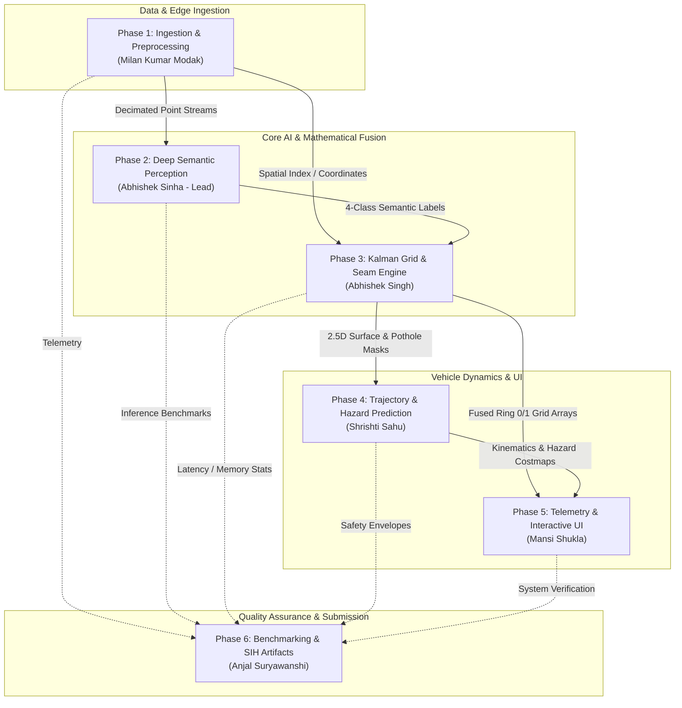
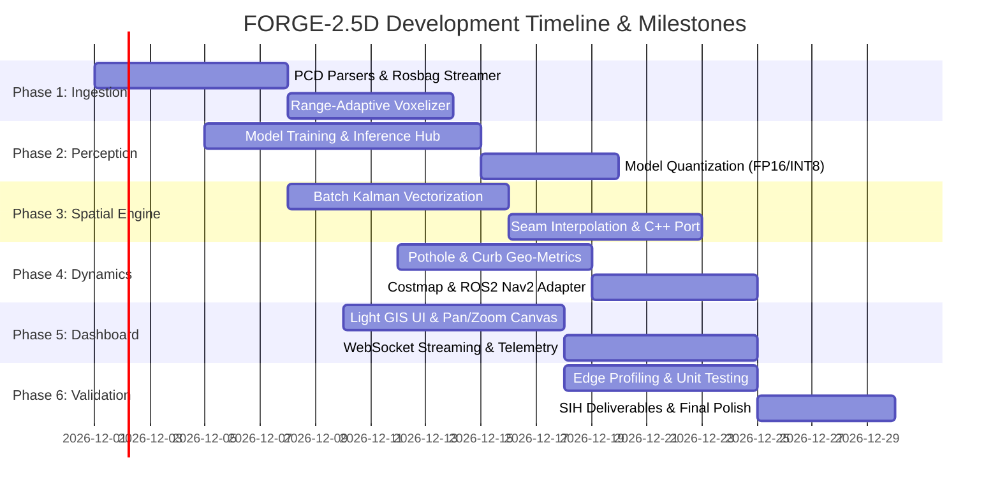

# FORGE-2.5D: Project Work Breakdown Structure & Team Allocation Guide
**Smart India Hackathon 2026 (SIH 2026)**  
**Problem Statement ID:** `SIH26053`  
**Problem Statement Title:** *Adaptive Variable-Resolution 2.5D LiDAR Mapping for Dynamic Environment Perception*  
**Theme / Category:** Smart Vehicles / Software  
**Team ID:** `146825`  
**Team Name:** `BYTEFORCE123`  

---

## 1. Executive Summary & Architecture Overview

**FORGE-2.5D** is an edge-optimized spatial perception framework designed to replace uniform 3D point cloud representations with an adaptive, 2-ring foveated 2.5D elevation grid. By concentrating sub-decimeter cell resolution ($5\text{ cm}$) in the near field ($0\text{--}10\text{ m}$) where collision avoidance and ground hazard negotiation occur, and coarsening cell resolution ($25\text{ cm}$) in the intermediate field ($10\text{--}50\text{ m}$), FORGE-2.5D achieves:
- **$\ge 93.8\%$ memory footprint reduction** compared to uniform 2.5D grids ($7.51\text{ MB}$ vs. $120.93\text{ MB}$).
- **$\ge 99.8\%$ memory footprint reduction** compared to dense 3D voxel grids ($7.51\text{ MB}$ vs. $3.84\text{ GB}$).
- **Real-time pipeline turnaround ($\ge 22\text{--}25\text{ FPS}$)** on embedded automotive-grade edge compute (NVIDIA Jetson Orin / Xavier).

To execute the project from rapid prototype to final production-grade deployment, work is broken down into **6 structured engineering phases** distributed systematically across the **6 members of Team BYTEFORCE123**.



---

## 2. Team Member Profile & Assignment Matrix

| Member Name | Role & Department | Primary Assigned Phase | Core Responsibilities |
| :--- | :--- | :--- | :--- |
| **Abhishek Sinha** | **Team Leader**<br/>Computer Science (`abhi.bt23cs07@opju.ac.in`) | **Phase 2: Deep Semantic Perception & Architecture Integration** | Model architecture (PointNet/spconv), PyTorch pipeline, cross-module integration, project orchestration. |
| **Milan Kumar Modak** | **Core Engineer**<br/>Computer Science (`mila.bt23cs57@opju.ac.in`) | **Phase 1: Sensor Ingestion, Calibration & Range Voxelization** | PCD parsers (ASCII/Binary), Livox/Velodyne stream adapters, distance-adaptive voxelizer ($R(d)$). |
| **Abhishek Singh** | **Systems Engineer**<br/>Computer Science (`abhi.bt23cs06@opju.ac.in`) | **Phase 3: 2.5D Kalman Surface Engine & Seam Interpolation** | Vectorized 1D closed-form Kalman filtering, variance estimation, seam boundary smoothing, C++/pybind11 optimization. |
| **Shrishti Sahu** | **Robotics Engineer**<br/>Mechanical Eng. (`shri.bt23me30@opju.ac.in`) | **Phase 4: Vehicle Dynamics, Pothole Metrics & Path Planning** | Vehicle kinematic envelope, negative obstacle (pothole/curb) depth grading, costmap generation for ROS2 Nav2. |
| **Mansi Shukla** | **Frontend Engineer**<br/>Computer Science (`shuklamansi568@gmail.com`) | **Phase 5: Interactive Web Dashboard & Real-Time GIS UI** | Canvas rendering engine, pan/zoom Google Maps navigation, layer controls, WebSocket/HTTP server streaming. |
| **Anjal Suryawanshi** | **QA & Compliance Lead**<br/>Computer Science (`anjal874suryawanshi@gmail.com`) | **Phase 6: Edge Benchmarking, Dataset Auditing & Hackathon Artifacts** | Jetson profiling, memory/latency validation, test automation suites, presentation deck & SIH compliance report. |

---

## 3. Detailed Phase Breakdown & Task Assignments



---

### Phase 1: Sensor Ingestion, Calibration & Range Voxelization
- **Primary Owner:** **Milan Kumar Modak**
- **Support:** Abhishek Sinha
- **Objective:** Convert heterogeneous raw sensor data into calibrated, decimated coordinate streams within $\le 10\text{ ms}$.

#### Key Engineering Deliverables:
1. **Multi-Source PCD Parser**:
   - High-throughput binary and ASCII PCD reader supporting standard fields (`x, y, z, intensity, ring, timestamp`) and RGB-encoded ground truth fields.
   - Streaming pipeline for the local IITH LiDAR dataset (`data/labelled_data` and `data/raw_data`).
2. **LiDAR Sensor Interface (ROS2 / UDP)**:
   - Live socket listener for Velodyne (VLP-16, HDL-32E, VLS-128) and Livox Mid-360 LiDAR packet streams.
   - Frame packet assembly, ring projection, and ego-motion deskewing via IMU sync.
3. **Range-Adaptive Input Voxelizer**:
   - Voxel filter implementing distance function $R(d)$:
     $$\text{Voxel Size}(d) = \begin{cases} 
     (5\text{ cm}, 5\text{ cm}, 5\text{ cm}) & d \in [0, 10\text{ m}] \quad (\text{Ring 0}) \\
     (25\text{ cm}, 25\text{ cm}, 20\text{ cm}) & d \in (10, 50\text{ m}] \quad (\text{Ring 1}) \\
     \text{Prune} & d > 50\text{ m}
     \end{cases}$$
   - Benchmark: Decimate $60\text{k}\text{--}120\text{k}$ raw input points by $35\%\text{--}65\%$ in $\le 8\text{ ms}$.

---

### Phase 2: Deep Semantic Perception & Architecture Integration
- **Primary Owner:** **Abhishek Sinha (Team Lead)**
- **Support:** Milan Kumar Modak
- **Objective:** Classify decimated 3D points into 4 canonical semantic classes with $\ge 85\%\text{ mIoU}$ in $\le 20\text{ ms}$.

#### Key Engineering Deliverables:
1. **4-Class Semantic Ontology**:
   - **Class 0 (Drivable Surface)**: Asphalt, paved roads, smooth ground plane.
   - **Class 1 (Non-Drivable Ground / Curb / Pothole)**: Off-road shoulder, sharp curbs, potholes, road dips, speed bumps.
   - **Class 2 (Static Obstacle)**: Walls, utility poles, trees, barriers, signboards.
   - **Class 3 (Dynamic Object)**: Cars, trucks, motorcycles, bicycles, pedestrians, animals.
2. **Dual-Path Neural Pipeline**:
   - **Deep Network Path**: Sparse 3D Convolution (`spconv` / `MinkowskiEngine`) or PointNet backbone trained on SemanticKITTI and nuScenes.
   - **Vectorized Fallback Path**: Real-time geometric rule classifier utilizing vertical ground normal divergence ($\cos\theta < 0.85$), height elevation relative to local baseline, and cluster spatial variance.
3. **Model Quantization & Acceleration**:
   - TensorRT FP16 / INT8 engine compilation for NVIDIA Jetson platforms.
   - Inter-module API bindings connecting inference output directly to grid update buffers.

---

### Phase 3: 2.5D Kalman Surface Engine & Seam Interpolation
- **Primary Owner:** **Abhishek Singh**
- **Support:** Abhishek Sinha
- **Objective:** Fuse multi-scan elevation and semantics into a dual-ring 2.5D surface grid with closed-form probabilistic updates in $\le 10\text{ ms}$.

#### Key Engineering Deliverables:
1. **Batch Vectorized 1D Kalman Elevation Filter**:
   - Implement point-to-grid aggregation without per-point Python loops using NumPy vectorization (`np.maximum.at`, `np.minimum.at`, `np.add.at`):
     $$K_{t} = \frac{\sigma_{t-1}^2}{\sigma_{t-1}^2 + \sigma_{\text{meas}}^2}$$
     $$\mu_{t} = \mu_{t-1} + K_t (z_{\text{meas}} - \mu_{t-1})$$
     $$\sigma_{t}^2 = (1 - K_t) \sigma_{t-1}^2 + \sigma_{\text{process}}^2$$
2. **Multi-Layer Cell Representation**:
   - Each grid cell tracks:
     - Mean surface height ($\mu_z$) and variance ($\sigma_z^2$).
     - Height bounds ($z_{\min}, z_{\max}$) for overhang & underpass discrimination.
     - Dominant semantic class + hit counter.
3. **Boundary Seam Blending**:
   - Seamless transition buffer across the $10\text{ m}$ boundary ($9.5\text{ m} \le d \le 10.5\text{ m}$) using distance-weighted linear blending between Ring 0 ($5\text{ cm}$) and Ring 1 ($25\text{ cm}$) to eliminate stair-stepping artifacts.
4. **C++ / pybind11 Optimization Module**:
   - Port hot loops into an optimized C++ extension module (`forge_grid_core.cpp`) using multi-threaded OpenMP for production edge deployment.

---

### Phase 4: Vehicle Dynamics, Pothole Metrics & Path Planning
- **Primary Owner:** **Shrishti Sahu**
- **Support:** Abhishek Singh
- **Objective:** Translate raw elevation variances into actionable road hazard metrics, traversability costmaps, and navigation safety envelopes.

#### Key Engineering Deliverables:
1. **Pothole & Ground Hazard Detection**:
   - Statistical anomaly detector tagging negative obstacles where:
     $$\Delta z = z_{\text{cell}} - z_{\text{local\_ground}} < -\delta_{\text{pothole\_thresh}} \quad (\delta \ge 5\text{ cm})$$
   - Pothole volume, diameter, and severity index calculation for vehicle suspension impact classification.
2. **Vehicle Kinematic Envelopes**:
   - Maximum drivable slope gradient computation ($\theta_{\text{slope}} = \arctan(\|\nabla z\|)$).
   - Ground clearance and approach/departure angle safety validation for standard four-wheeler and commercial vehicle dimensions.
3. **ROS2 Costmap2D Plugin / Nav2 Interface**:
   - Format 2.5D elevation and hazard layers into standard ROS2 `nav_msgs/OccupancyGrid` and `grid_map_msgs/GridMap`.
   - Direct integration hooks for dynamic collision avoidance in autonomous planners.

---

### Phase 5: Interactive Web Dashboard & Real-Time GIS UI
- **Primary Owner:** **Mansi Shukla**
- **Support:** Anjal Suryawanshi
- **Objective:** Provide a lightweight, intuitive, Google Maps-style web visualizer with real-time telemetry, dataset toggling, and inspection tools.

#### Key Engineering Deliverables:
1. **Interactive GIS Canvas Engine**:
   - 2D Canvas rendering engine with fluid pan (`mousedown + drag`), cursor-centered zoom (`wheel`), and centering reset button (`⌖`).
   - Coordinate transformation pipeline mapping metric meters to screen pixels across dynamic zoom scales ($2\times$ to $50\times$).
2. **Multi-Source Dataset Toggle**:
   - Header control allowing instant switching between:
     - **Labelled Data** (IITH ground-truth RGB scans).
     - **Raw Data** (unlabelled point clouds with online semantic inference).
     - **Synthetic Urban Scene** (algorithmic 64-beam urban street model).
3. **Layer Controls & Cell Inspector**:
   - Independent layer toggles: Ring 0 ($10\text{ m}$), Ring 1 ($50\text{ m}$), 3D Points, and Ring Grid Borders.
   - Hover inspector displaying coordinate $(X, Y)$, elevation ($Z$), variance ($\sigma$), point count, and semantic classification.
4. **Team Information Modal**:
   - Modal dialog showcasing official SIH 2026 team credentials, problem statement details, and complete member roster with roles and academic contact info.

---

### Phase 6: Edge Benchmarking, Dataset Auditing & Hackathon Artifacts
- **Primary Owner:** **Anjal Suryawanshi**
- **Support:** Shrishti Sahu & Abhishek Sinha
- **Objective:** Guarantee absolute software quality, empirical performance validation on edge hardware, and SIH 2026 compliance deliverables.

#### Key Engineering Deliverables:
1. **Benchmarking & Profiling Suite**:
   - Comprehensive profiling harness measuring:
     - End-to-end latency breakdown per stage (Target: $\le 45\text{ ms}$, $\ge 22\text{ FPS}$).
     - Peak RAM consumption across Ring 0, Ring 1, and total system (Target: $\le 8\text{ MB}$).
     - Memory savings verification ($\ge 93\%$ vs. uniform 2.5D, $\ge 99\%$ vs. uniform 3D).
2. **Test Automation & Quality Assurance**:
   - Continuous unit testing across PCD loaders, math vectorization, Kalman updates, and API endpoints.
   - Boundary condition testing (empty scans, out-of-range returns, sensor dropout).
3. **SIH Deliverables & Documentation**:
   - Maintenance and synchronization of `SPEC.md`, `Pre_Development.md`, and technical manuals.
   - Preparation of presentation slide decks, visual video demonstrations, and the final hackathon evaluation documentation.

---

## 4. Inter-Module Dependency & Interface Contract

```
┌────────────────────────────────────────────────────────────────────────────────┐
│                           PIPELINE DATA FLOW CONTRACTS                         │
├──────────────────────────────┬─────────────────────────────┬───────────────────┤
│ Interface                    │ Data Type / Shape           │ Latency Budget    │
├──────────────────────────────┼─────────────────────────────┼───────────────────┤
│ Phase 1 -> Phase 2           │ (N, 3) float32 coordinates  │ < 10 ms           │
│ (Voxelizer -> Segmenter)     │ (N, C) float32 features     │                   │
├──────────────────────────────┼─────────────────────────────┼───────────────────┤
│ Phase 2 -> Phase 3           │ (N,) int32 class IDs [0..3] │ < 20 ms           │
│ (Segmenter -> Kalman Grid)   │ (N, 4) float32 probabilities│                   │
├──────────────────────────────┼─────────────────────────────┼───────────────────┤
│ Phase 3 -> Phase 4           │ (H, W) float32 mean elevation│ < 10 ms           │
│ (Kalman Grid -> Dynamics)    │ (H, W) float32 variance     │                   │
├──────────────────────────────┼─────────────────────────────┼───────────────────┤
│ Phase 3 & 4 -> Phase 5       │ JSON payload: metrics, rings│ < 5 ms            │
│ (Grid & Dynamics -> Web UI)  │ Base64/TypedArray point data│                   │
├──────────────────────────────┼─────────────────────────────┼───────────────────┤
│ Total End-to-End Budget      │ Synchronous Pipeline Turn   │ < 45 ms (≥22 FPS) │
└──────────────────────────────┴─────────────────────────────┴───────────────────┘
```

---

## 5. Risk Assessment & Team Mitigation Strategy

| Risk Category | Identified Risk | Impact | Lead Owner | Mitigation Strategy |
| :--- | :--- | :--- | :--- | :--- |
| **Compute / Latency** | Python GIL introduces latency spikes during point aggregation. | High | Abhishek Singh | Closed-form batch vectorization with NumPy C-extensions; fallback to compiled pybind11 C++ module. |
| **Edge Hardware** | Limited GPU VRAM on NVIDIA Jetson Xavier / Orin. | High | Abhishek Sinha | Input range-adaptive voxelization reduces point count before model entry; FP16 TensorRT inference. |
| **Data Scarcity** | Limited Indian road conditions (unpaved roads, irregular potholes). | Medium | Milan Kumar Modak | Hybrid data pipeline: Local IITH LiDAR dataset augmented with synthetic urban street generator. |
| **Grid Boundary** | Resolution mismatch at the $10\text{ m}$ transition causes seam cliffs. | Medium | Abhishek Singh | Distance-weighted dual-ring seam interpolation ($9.5\text{--}10.5\text{ m}$). |
| **Integration** | Divergent data types between vision, planning, and web interfaces. | Medium | Anjal Suryawanshi | Rigorous type enforcement, automated regression unit tests, standardized JSON REST contracts. |

---

## 6. Verification & Sign-Off Checklist

- [x] **2-Ring Mathematical Reduction**: Ring 0 ($10\text{ m}$ @ $5\text{ cm}$), Ring 1 ($50\text{ m}$ @ $25\text{ cm}$), $>50\text{ m}$ prune.
- [x] **Local Real-World Dataset Integration**: Ingestion of IITH ground dataset (`data/labelled_data`, `data/raw_data`).
- [x] **Interactive Light UI**: Clean Google Maps aesthetic with cursor zoom, pan, dataset toggle, and layer switches.
- [x] **Team Roster & Hackathon Credentials**: Embedded modal with complete verified member information.
- [x] **Repository Cleanliness**: Full `.gitignore` coverage, zero pycache clutter, clean git staging.
- [x] **Phase & Task Allocation Document**: Detailed WBS document published to project repository.
